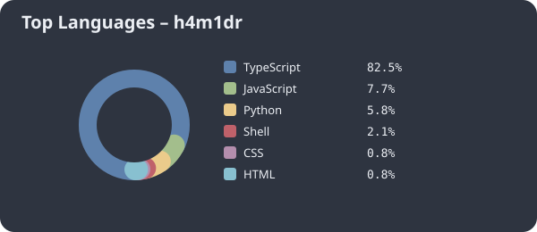
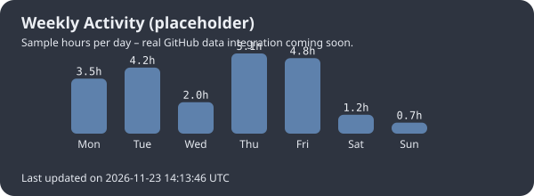
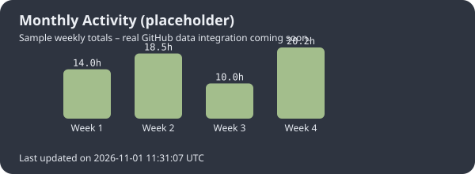
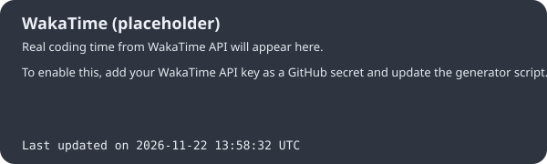

# h4m1dr-profile-stats

The engine behind my GitHub profile widgets. It generates SVG charts from my
public GitHub activity and serves them as raw files for the profile README
([h4m1dr/h4m1dr](https://github.com/h4m1dr/h4m1dr)) to embed.

This is the single stats repo. The older
[h4m1dr/h4m1dr-stats](https://github.com/h4m1dr/h4m1dr-stats) is deprecated —
it ran the same scripts and workflows; it is kept for history only.

## Widgets

| Widget | Status | File |
| --- | --- | --- |
| Top Languages (donut) | Live — real data from the GitHub `/languages` API | `assets/top_langs.svg` |
| Weekly Activity | Placeholder — sample data, real GitHub data not wired yet | `assets/weekly_activity.svg` |
| Monthly Activity | Placeholder — sample data, real GitHub data not wired yet | `assets/monthly_activity.svg` |
| WakaTime coding time | Placeholder — needs a `WAKATIME_API_KEY` secret and a real generator | `assets/wakatime.svg` |

### Top Languages



```md

```

### Weekly Activity



```md

```

### Monthly Activity



```md

```

### WakaTime



```md

```

## How it works

- `scripts/generate_top_langs_svg.py` — aggregates `/languages` byte counts
  across all non-fork public repos and draws the donut.
- `scripts/generate_weekly_activity_svg.py` / `generate_monthly_activity_svg.py` —
  draw sample data for now; they need to be wired to real contribution data
  (GitHub GraphQL, like the profile repo's `update_ascii_activity.py`).
- `scripts/generate_wakatime_svg.py` — writes a placeholder; wire it to the
  WakaTime API (secret `WAKATIME_API_KEY`) for real coding time.
- `scripts/generate_activity_blocks.py` — legacy text-block generator, same code
  as the old stats repo; not used by this README.

Workflows in `.github/workflows/`:

- `update_langs.yml` — regenerates the Top Languages donut.
- `update_weekly_activity.yml` — Mondays 04:00 UTC, regenerates `weekly_activity.svg`.
- `update_monthly_activity.yml` — regenerates `monthly_activity.svg`.
- `update_wakatime.yml` — regenerates `wakatime.svg`.
- `update_activity.yml`, `waka.yml` — legacy, carried over from the old stats
  repo; `update_activity.yml` has nothing to update here (this README has no
  activity markers) and can be removed.

## Output folders

- `assets/` — public SVGs, embedded by the profile README.
- `dist/` — reserved for future Markdown snippets (currently empty).
